  

  

  &nbsp;
  &nbsp;
  &nbsp;
  

  

---

<h2 align="center">🔴 About Me</h2>

  

  Hi! I'm <b>Piratheep Rajaratnam</b>, a <b>full-stack developer</b> based in <b>Jaffna, Sri Lanka</b>, working remotely with teams in Norway, the UK and Australia. 
  I have <b>4+ years of commercial experience</b> building and maintaining production websites and business systems in <b>PHP and JavaScript</b> —
  from custom WordPress plugins and WooCommerce stores to Laravel + React platforms and zero-downtime legacy migrations.

  &nbsp;
  &nbsp;
  &nbsp;
  

  💬 <b>Ask me about:</b> PHP 8, Laravel, React, Next.js, WordPress plugin development, WooCommerce, MySQL and Cloudflare. 
  ⚡ <b>How I work:</b> <i>Tickets to PR review to release — with clear written updates across time zones.</i>

<table width="100%" border="0" align="center">
  <tr>
    <td width="50%" align="center" style="padding: 14px;">
      <h4>💼 Software Developer</h4>
      
<b>AC Tech Solutions (Digifront)</b> Norway · Remote · 2024 – Present

    </td>
    <td width="50%" align="center" style="padding: 14px;">
      <h4>🚀 Co-Founder &amp; CTO</h4>
      
<a href="https://sixvm.com.au" target="_blank"><b>SixVM Pty Ltd</b></a> AI automation, agents &amp; web · Australia

    </td>
  </tr>
  <tr>
    <td width="50%" align="center" style="padding: 14px;">
      <h4>🤝 Volunteer Main Developer</h4>
      
<a href="https://wisdomtrust.org" target="_blank"><b>Wisdom Trust</b></a> UK registered charity · WordPress member platform

    </td>
    <td width="50%" align="center" style="padding: 14px;">
      <h4>🎓 Education</h4>
      
<b>BEng (Hons) Software Engineering</b> London Metropolitan University

    </td>
  </tr>
</table>

---

<h2 align="center">🔴 Featured Work</h2>

<table width="100%" border="0" align="center">
  <tr>
    <td width="50%" valign="top" style="padding: 18px;">
      <h3>🔄 Legacy PHP Migration</h3>
      
<i>Migrated the Coupon System and SMS Gateway from PHP 5.2 to PHP 8, Laravel 11 and React — untangling undocumented code and preserving live behaviour without downtime.</i>

      
  

    </td>
    <td width="50%" valign="top" style="padding: 18px;">
      <h3>🧠 EasyKnow Knowledge Platform</h3>
      
<i>Role-based knowledge platform with approval workflows, Zoho Mail parsing, auto-FAQ generation and an AI-powered content-improvement feature built on the Claude API.</i>

      
   

    </td>
  </tr>
  <tr>
    <td width="50%" valign="top" style="padding: 18px;">
      <h3>🎫 Queue &amp; Dispatch Management</h3>
      
<i>Real-time queue system for a retail client — token generation, appointment and walk-in flow, notifications, and separate staff and admin dashboards.</i>

      
  

    </td>
    <td width="50%" valign="top" style="padding: 18px;">
      <h3>🌐 WordPress Client Websites</h3>
      
<i>Responsive WordPress sites with third-party integrations for Norwegian and UK clients, including the magazine sites <a href="https://utrop.no">utrop.no</a> and <a href="https://motorsport.no">motorsport.no</a>.</i>

      
  

    </td>
  </tr>
  <tr>
    <td width="50%" valign="top" style="padding: 18px;">
      <h3>🏷️ PID Update Application</h3>
      
<i>Asset traceability system with unique product IDs, QR-code generation, secure Node.js APIs over PostgreSQL and a responsive UI for field record capture.</i>

      
  

    </td>
    <td width="50%" valign="top" style="padding: 18px;">
      <h3>❤️ Wisdom Trust Member Platform</h3>
      
<i>Custom PHP plugins for points and credits, charity voting, grants and membership, plus WooCommerce, server, backups and Cloudflare. Migration to Next.js in progress.</i>

      

    </td>
  </tr>
</table>

---

<h2 align="center">🛠️ Tech Stack &amp; Skills</h2>

<b>Languages</b>

  

<b>Frameworks &amp; Front-End</b>

  

<b>CMS, Databases &amp; Servers</b>

  

<b>Workflow &amp; AI-Assisted Development</b>

  &nbsp;
  &nbsp;
  &nbsp;
  &nbsp;
  &nbsp;
  

---

<h2 align="center">📊 GitHub Analytics &amp; Activity</h2>

  &nbsp;
  

  

  

---

<h2 align="center">⚡ Contribution Journey</h2>

  

---

<h2 align="center">📬 Let's Connect &amp; Collaborate</h2>

<i>Open to remote full-stack, PHP/Laravel and WordPress roles — and always happy to talk about legacy migrations and AI-assisted development.</i>

<table border="0" align="center">
  <tr>
    <td align="center" width="220" style="padding: 16px;">
      <a href="https://www.linkedin.com/in/piratheep-rajaratnam-a3aa97195/" target="_blank">
          
        
      </a> 
      <b>Professional Network</b>
    </td>
    <td align="center" width="220" style="padding: 16px;">
      <a href="https://sixvm.com.au" target="_blank">
          
        
      </a> 
      <b>AI Solutions Company</b>
    </td>
    <td align="center" width="220" style="padding: 16px;">
      <a href="mailto:piratheeptheep99@gmail.com">
          
        
      </a> 
      <b>Direct Collaboration</b>
    </td>
  </tr>
</table>

  

